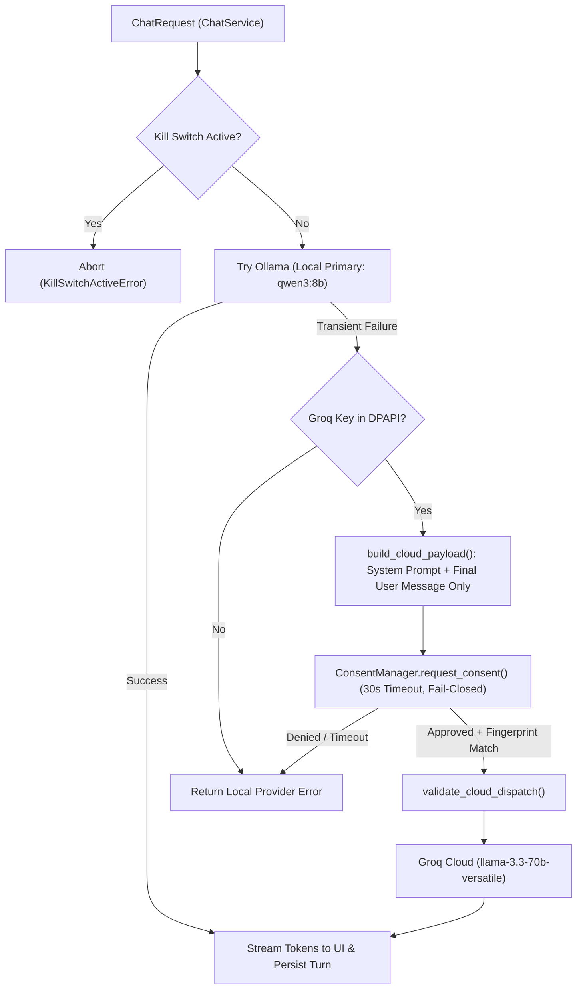

# AI Architecture

JARVIS routes all AI requests through a unified, local-first `LLMRouter` (`src/jarvis/intelligence/router.py`).

---

## Local-First Routing & Consent-Gated Cloud Fallback

---

## Key Modules (`src/jarvis/intelligence/`)

- **`router.py` (`LLMRouter`):** Enforces local-first ordering, retry policy (bounded by `routing_max_retries`, honoring `Retry-After` on HTTP 429, exponential backoff), total request budget, and cached health checks (`health_hard_down_ttl_seconds`).
- **`ollama_client.py`:** Primary local provider (`http://localhost:11434`, `qwen3:8b`, `keep_alive="10m"`, `think=false` by default).
- **`groq_client.py`:** Optional cloud fallback (`llama-3.3-70b-versatile` via `https://api.groq.com/openai/v1`), authenticated via DPAPI `groq_api_key`.
- **`cloud_payload.py`:** The **only** sanctioned path for constructing cloud payloads. Strips history, memories, retrieved RAG chunks, files, tool outputs, and environment state, binding the 2-message payload with a SHA-256 fingerprint.
- **`consent.py` (`ConsentManager`):** Per-request, fail-closed consent bound to `(request_id, fingerprint)`.
- **`chat_service.py`:** Coordinates streaming tokens, cancellation (`Stop` button), and durable persistence via `ConversationService`.
