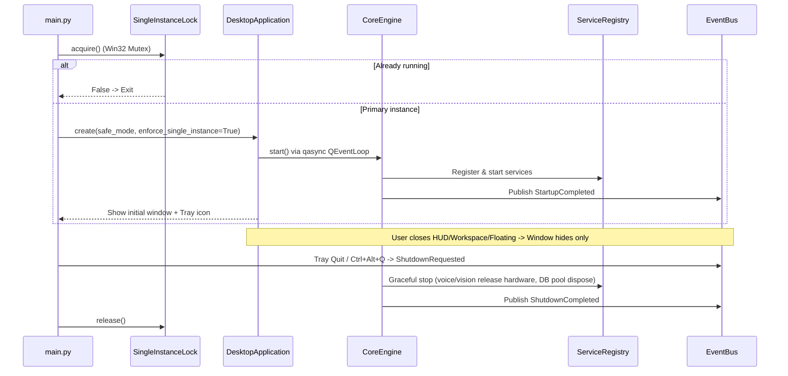

# Application Lifecycle

JARVIS separates **window visibility** from **engine lifecycle**: hiding or closing a window never stops background services, active conversations, or the `EventBus`.

---

## Startup & Shutdown Sequence

---

## Key Components

- **`main.py`:** Parses `--safe-mode`, acquires `SingleInstanceLock`, creates `DesktopApplication.create(safe_mode=..., enforce_single_instance=True)`, and runs `qasync.QEventLoop`.
- **`CoreEngine` (`src/jarvis/core/engine.py`):** Coordinates `ServiceRegistry`, `LifecycleManager`, and `EventBus`. In `safe_mode`, skips optional hardware/agent modules for recovery.
- **`CrashRecoveryManager` (`src/jarvis/core/recovery.py`):** Tracks unclean shutdowns and assists safe recovery.
- **Independent Windows:** `WindowManager` (`src/jarvis/desktop/window_manager.py`) switches between HUD, Workspace, and Floating views without recreating `CoreEngine`.
