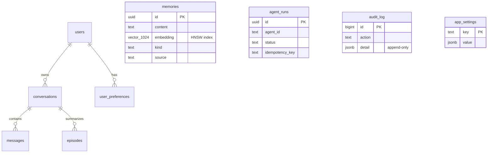

# Database Architecture

JARVIS uses **PostgreSQL 16** with the **`pgvector`** extension (`pgvector/pgvector:pg16`), accessed asynchronously via `SQLAlchemy[asyncio]` and `asyncpg` (`src/jarvis/database/connection.py`).

---

## Schema Overview (`src/jarvis/database/models.py`)

Alembic head revision: **`0003_agent_runtime`**.

### Core Tables

| Table | Purpose | Notes |
| :--- | :--- | :--- |
| `users` | Local user profile records | — |
| `conversations` | Conversation threads & metadata | Managed by `ConversationService` |
| `messages` | Turn-by-turn messages & reconciliation state | Supports bounded persistence deadlines |
| `memories` | Long-term semantic & RAG chunks | `vector(1024)` column with HNSW index |
| `episodes` | Episodic conversation summaries | Linked to conversations |
| `user_preferences` | Structured user preference records | — |
| `agent_runs` | Autonomous agent execution state | Strict state transitions + idempotency |
| `audit_log` | Security & execution audit trail | Append-only enforced at DB level |
| `app_settings` | Persisted non-secret app preferences & scheduler jobs | Managed by `PreferencesService` & `ScheduledJobStore` |

---

## Connection & Resilience

- `DatabaseService` uses async connection pooling with `pool_pre_ping` and reconnect backoff.
- `vector(1024)` dimension is fixed per database (`JARVIS_EMBEDDING_DIM=1024`) and changed only via explicit Alembic migration.
- Raw camera frames, face crops, and biometric embeddings are **never** stored in PostgreSQL.
