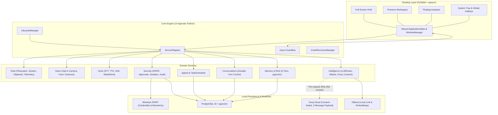

# System Overview

JARVIS 1.0.0 is a **native Windows 11 desktop application** built in Python 3.12 with **PySide6**, **qasync**, **PostgreSQL + pgvector**, and **Ollama**. There is no web server, no HTML frontend, and no WebView/Electron shell.

---

## Layered Architecture

---

## Core Architectural Principles

1. **Strict UI/Core Separation:** `src/jarvis/core/` and all domain services never import `PySide6`. The desktop shell communicates via typed Python interfaces and `EventBus`.
2. **Single Shared Engine:** Closing or hiding HUD, Workspace, or Floating windows does not stop `CoreEngine`. Only tray **Quit** or `Ctrl+Alt+Q` triggers `ShutdownRequested`.
3. **Local-First AI & Fail-Closed Security:** Ollama is primary; Groq requires per-request consent and strict 2-message isolation. Tool execution and camera access fail closed by default.
